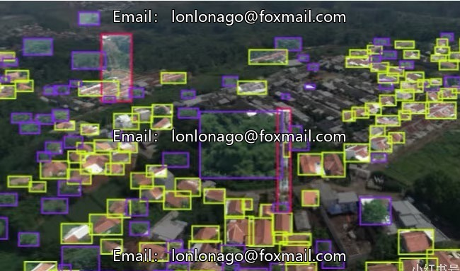
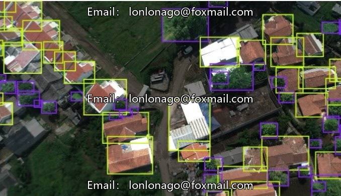
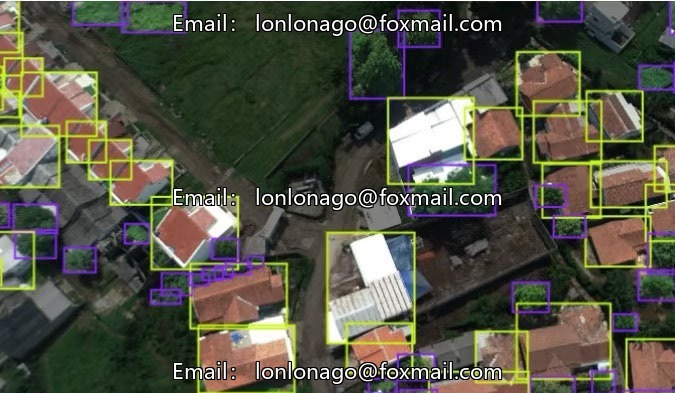

# Drone aerial photography dataset (10053 issue)

## Body

Drone aerial photography dataset (10053 issue) - Drone aerial inspection dataset, DJI drone aerial photography of houses, roofs, signal towers, trees with high resolution, issue 10053

The dataset consists of 1000 aerial drone images, suitable for drone scene recognition and target detection model training. The annotation information is abundant, with 183 annotations per image, covering three major categories: House (house), Tower (tower), Trees (trees). The label system is clear, the data volume is moderate, and it can be used for basic model validation and debugging.

Virtual materials, once sold, are non-refundable.
Interested friends, click "I want" to proceed.

## Images

## Payment

Here is a pay link on Stripe ( https://buy.stripe.com/3cs8yP7sY87d0vu9AB ). Please contact me lonlonago@foxmail.com after funding $89, and I will send you a complete data files , thank you!

